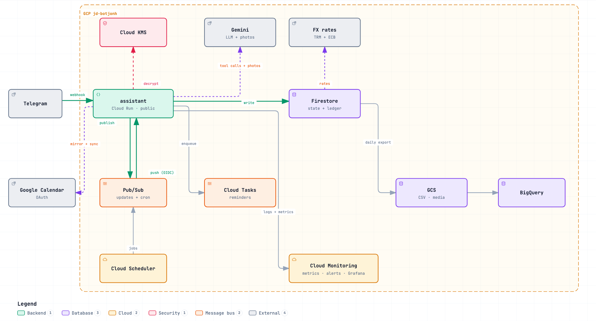

<p align="center">
  
</p>

<h1 align="center">Juani</h1>

<p align="center">
  Your expense and calendar assistant on Telegram · Español · English · 中文 · Français · Deutsch · Português
</p>

**Juani** (repo `telegram-personal-assistant`) is a Telegram bot that logs your
expenses and income, shows your month on a pinned dashboard, recommends how to
save, keeps your agenda with on-the-minute reminders and reads photos of meals
and receipts. It runs for one owner and up to 100 people the owner lets in, on
GCP, for about $1–2/month (LLM tokens only).

## What Juani does

- **Logs money in one line.** `-12 lunch`, `2000 cop cafe`, `+1500 salario`
  are registered by code with zero LLM tokens; free text goes to the LLM. Each
  entry comes back as stored; `/anular 1` voids the last one to write it again.
- **Works in your currency.** USD, EUR, GBP, COP, MXN, PEN, BRL or CNY, picked in a small
  Mini App that also reads your phone's time zone. Amounts in another currency
  (`20 eur cena`) are converted at the day's rate.
- **Shows your month.** The pinned *Visor de gastos* opens a Telegram Mini App
  with income, spend by category and day, and the savings rate. No secret in
  the URL: Telegram signs the user in.
- **Keeps you on track.** On Sunday at 18:00, how the week went against the 20%
  savings rule (one tap turns it off); no daily spending messages.
- **Runs your agenda.** Appointments and reminders in natural language,
  conflict checks and one-tap calendar connect: two-way sync with Google
  Calendar, or a private feed for iPhone and Outlook.
- **Reads photos.** A meal gives estimated calories, macros and meal times; a
  receipt is split between people, and `cuentas` shows who still owes you.
- **Tracks a meal plan if you want.** `/plan` takes your goal, age, weight and
  height and sets a daily calorie target; each meal shows what is left.
  Estimates, not medical advice.
- **Speaks your language.** Spanish, English, Chinese, French, German or Portuguese, following your phone (English for any other language).
- **Lets people in on request.** A stranger taps Start and the owner accepts
  or rejects; inactive or revoked users are erased after 60 or 30 days, and
  their ledger rows stay only as anonymous history.
- **Has fun if you want.** `/fun` turns on reaction images, picked by category and by how healthy your meal is.

The full guide, with every command and example, is in the documentation below.

## How it works



One Cloud Run service, scaled to zero. The Telegram webhook only verifies the
update, publishes it to Pub/Sub and acks in under 300 ms; Pub/Sub pushes it
back to the same service, which calls the LLM (Gemini Flash-Lite, tool calling),
writes to Firestore and replies on its own request. Photos also go to Gemini; Google
Calendar tokens are encrypted with Cloud KMS. Reminders are Cloud Tasks; the
morning agenda, the Sunday summary, calendar sync and data retention run from
an hourly Cloud Scheduler job. Cloud Monitoring collects request and
LLM metrics and mails alerts, always on; a local Grafana explores them
([monitoring/](monitoring/README.md)). Interactive diagrams live
in [`docs/architecture/`](docs/architecture/).

## Documentation

| Document | What it covers |
|---|---|
| [User guide](https://juandsep.github.io/telegram-personal-assistant/guia/) | Short guide for non-technical users (es/en), the bot's 🗺️ Guía completa button |
| [docs/USAGE.md](docs/USAGE.md) | Access, currency, logging, corrections, dashboard, scheduled messages, reactions, agenda, photos, commands |
| [docs/DATA.md](docs/DATA.md) | Ledger model, CSV export and backup, retention, Looker Studio, Firestore collections |
| [docs/DEPLOY.md](docs/DEPLOY.md) | Running your own Juani on GCP, configuration variables, admin CLI |
| [monitoring/README.md](monitoring/README.md) | Metrics, alerts, slow-call logs, local Grafana |
| [CONTRIBUTING.md](CONTRIBUTING.md) | Branch flow, commits, local checks, releases |
| [ROADMAP.md](ROADMAP.md) | The original plan: decisions, architecture, costs, security, roadmap |

## Run locally

Requires [uv](https://docs.astral.sh/uv/) and Python 3.12.

```bash
uv sync
uv run pre-commit install
uv run pytest
uv run mypy src
uv run ruff check . && uv run ruff format --check .
```

Local runs read a git-ignored `.env` with the same variables as the deploy (see
[docs/DEPLOY.md](docs/DEPLOY.md#configuration)).

**Stack:** FastAPI, httpx (Gemini, Telegram, Google Calendar),
`google-cloud-*` (Firestore, Pub/Sub, Storage, Tasks, KMS), Cloud Monitoring + Grafana, uv + ruff + mypy +
pytest, Terraform, GitHub Actions.

## Deploy

Juani runs on GCP: Terraform for the base infrastructure, GitHub Actions for
the Cloud Run service (`dev` deploys `assistant-staging`, `main` deploys
`assistant`).
Step by step, the bot profile, every configuration variable and the admin CLI:
see [docs/DEPLOY.md](docs/DEPLOY.md).

## Contributing

Changes go on a `feat/`, `fix/` or `chore/` branch cut from `dev` and merge
into `dev` through a pull request; merging `dev` into `main` releases. See
[CONTRIBUTING.md](CONTRIBUTING.md).
